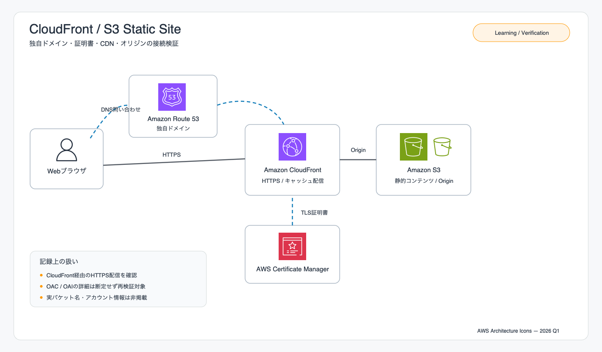

# AWS CloudFront / S3 Static Site

Amazon S3に配置した静的コンテンツをAmazon CloudFrontから配信し、Route 53とACMを組み合わせてHTTPSでアクセスする構成を確認した学習・検証環境です。

S3へ直接アクセスする場合とCloudFrontを経由する場合の違いを確認し、DNS、証明書、CDN、オリジンの関係を整理しました。

## Terraformでの再構築

手作業で確認した構成をコードでも再現できるよう、[Terraformコード](terraform/)を追加しました。今回はCloudFrontの標準ドメインでHTTPS配信する最小構成です。独自ドメイン、Route 53、ACMはこのコードの作成対象に含めていません。

S3のパブリックアクセスをブロックし、OACで対象のCloudFrontからだけオブジェクトを取得できるようにしています。過去の手作業の記録と、今回コードにした構成は分けて記載しています。

- [Terraformの実行・更新・削除手順](docs/terraform-guide.md)
- [今回の作業状況](docs/terraform-status.md)

## 構成

構成図には[AWS公式のArchitecture Icons](https://aws.amazon.com/architecture/icons/)を使用しています。

## 使用技術

| 分類 | 使用技術 |
|---|---|
| ストレージ | Amazon S3 |
| CDN | Amazon CloudFront |
| DNS | Amazon Route 53 |
| 証明書 | AWS Certificate Manager |
| 通信 | HTTPS、DNS |

## 実施内容

1. S3バケットへ静的コンテンツを配置
2. S3をオリジンとしてCloudFront Distributionを作成
3. CloudFrontのドメインからコンテンツを表示
4. ACMで証明書を準備
5. Route 53でCloudFrontへのDNSレコードを設定
6. 独自ドメインからHTTPSでアクセス
7. S3直接アクセスとCloudFront経由の動作を比較

## 確認したポイント

- Route 53は名前解決を行い、実際のコンテンツ配信はCloudFrontが担当すること
- ACM証明書とCloudFrontの代替ドメイン名が一致している必要があること
- S3はオリジン、CloudFrontは利用者に近い場所から配信するCDNとして動作すること
- 設定変更後はCloudFrontへの反映に時間がかかる場合があること
- キャッシュが残っていると、S3の更新がすぐ表示されない場合があること

## 接続できない場合の確認順序

1. Route 53のレコード
2. CloudFrontの代替ドメイン名
3. ACM証明書の状態とリージョン
4. CloudFront Distributionの状態
5. S3オリジンの指定
6. S3側のアクセス設定
7. CloudFrontのキャッシュ

DNS、証明書、CloudFront、S3を分けて確認すると、どこで接続が止まっているか整理しやすくなります。

## 詳しい記録

- [構築・再現手順](docs/build-guide.md)
- [検証内容と切り分け記録](docs/verification-record.md)

## 記載していない内容

OACまたはOAIをどの設定で使用したかは当時の記録を確認できなかったため、このリポジトリでは設定済みと断定していません。再検証できた場合に追記します。

## セキュリティ上の配慮

- AWSアカウントIDや実際のバケット名を掲載しない
- アクセスキーや秘密情報をリポジトリへ含めない
- S3の公開範囲は、CloudFrontからのアクセス方式を再確認してから設定する

## 注意事項

このリポジトリはAWSの学習・ハンズオン内容を再構成したものです。業務で構築した環境ではありません。

